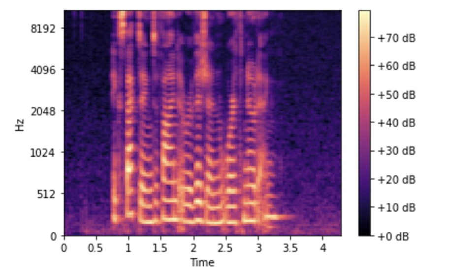
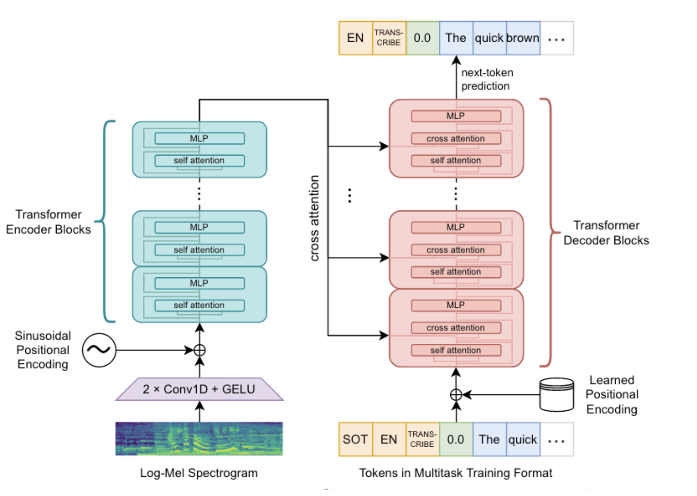
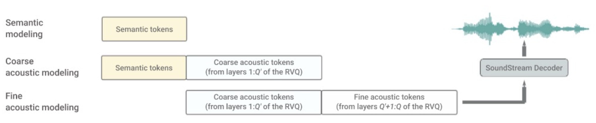
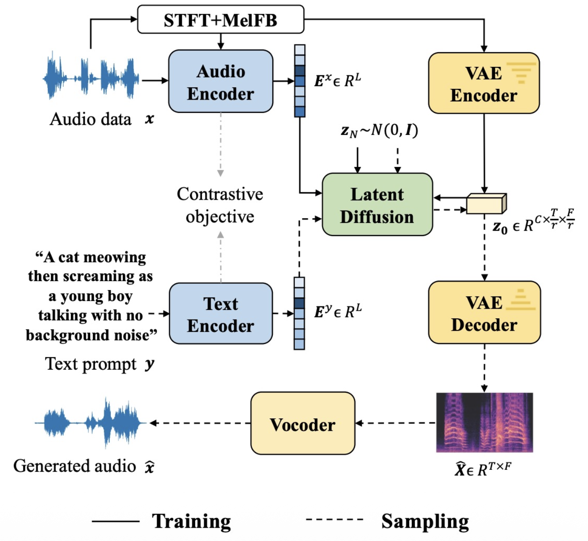
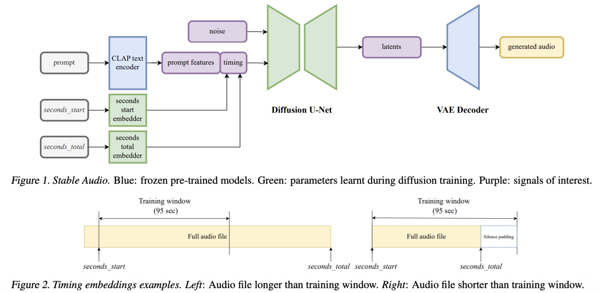
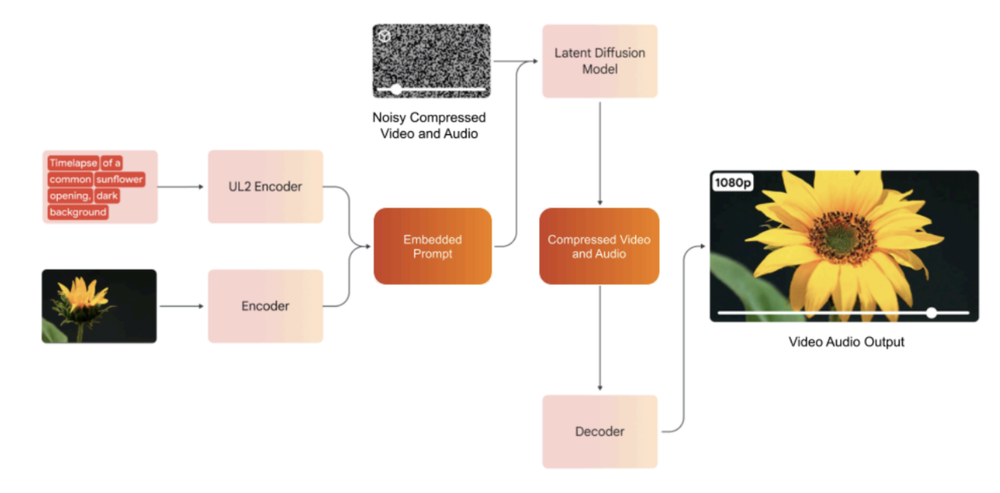

# Audio Representations
## Pulse-Code Modulation (PCM)
A raw recording has several parameters:
- number of channels.
- bit depth.
- sampling rate.
## Mel Spectrogram
A Mel spectrogram shows how the energy of an audio spreads over frequency and time.
- if the audio is a single unchanging sound, we could run a single FFT to extract the sinusoidal waves that gave rise it.
- in practice the sound changes over time.
- a spectrogram runs many FFTs on overlapping windows.
- a mel spectrogram passes the frequencies through a frequency-to-mel map.

# Whisper
Whisper is trained on multiple tasks:
- English transcription.
- Any-to-English speech translation.
- Non-English transcription.
- No speech.

# Gemini
Multimodal large language models (e.g. Gemini) are trained with many different modalities as input.

# AudioLM
AudioLM has 2 tokenizers:
- acoustic: SoundStream
- semantic: w2v-BERT

It generates audio tokens in 3 stages.

# AudioLDM
AudioLDM uses a latent diffusion model to generate the Mel spectrogram.

# Stable Audio
Stable Audio conditions on the start time and total time of the audio to enable variable length audio generation.

# Veo 3
Veo 3 is a video diffusion model that simultaneously diffuses audio.

