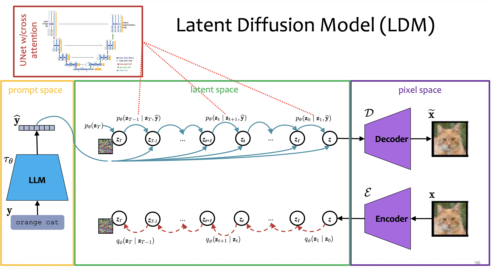
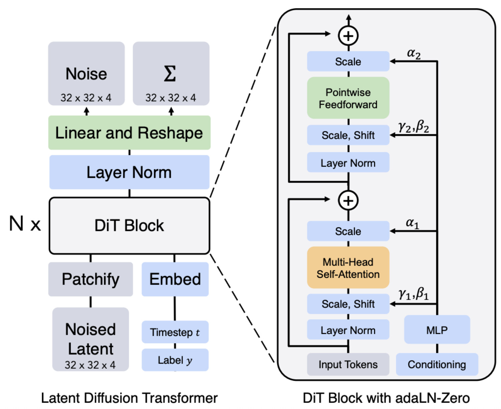
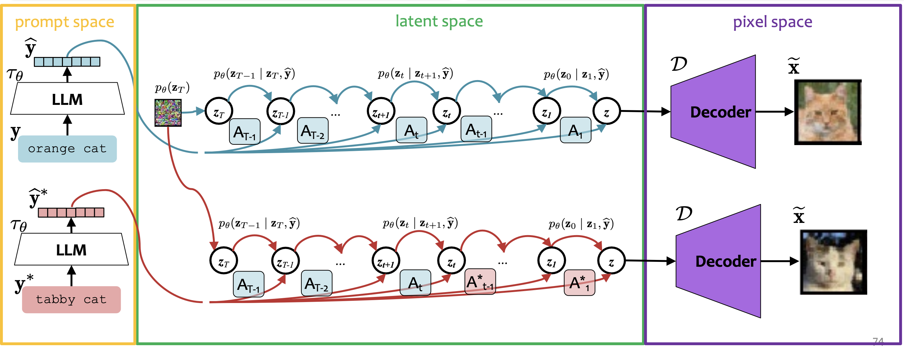
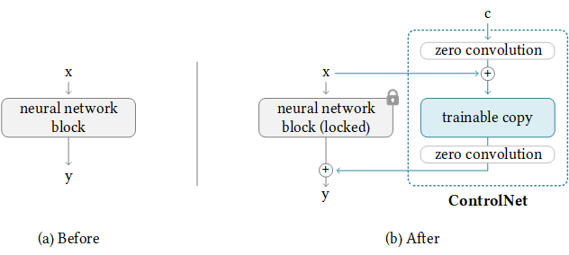

# Latent Diffusion Models
Diffusion models in pixel space is slow in training and inference.

Latent diffusion models train an auto-encoder that learns **an efficient latent space that is perceptually equivalent to the data space**, then train a diffusion model on the latent representations.

Latent diffusion models improve the efficiency of diffusion models.

The auto-encoder encodes the image from pixel space to latent space. VAE is often used as the auto-encoder in latent diffusion models.

A standard VAE is trained with a reconstruction loss plus KL regularization. However, the VAE used as an auto-encoder in latent diffusion models is often also trained with a perceptual loss, an adversarial loss and **relatively weak KL regularization**. The focus of the VAE here is compression and reconstruction, rather than distribution modeling.

# Conditional Diffusion Models
Forward process:
$$
q_\phi (x_0) = \text{data distribution}
$$
$$
q_\phi(\mathbf{x}_t | \mathbf{x}_{t-1}) \sim \mathcal{N}(\sqrt{\alpha_t} \mathbf{x}_{t-1}, (1 - \alpha_t)\mathbf{I})
$$

Exact reverse process:
$$
q_T\approx\mathcal N(0,I)
$$
$$
q_\phi(\mathbf x_{t-1} | \mathbf x_t, \mathbf y) = \text{intractable}
$$

Learned reverse process:
$$
p_\theta(\mathbf{x}_T) \sim \mathcal{N}(\mathbf 0, \mathbf I)
$$
$$
p_\theta(\mathbf{x}_{t-1} | \mathbf{x}_t, \mathbf y) \sim \mathcal{N}(\mu_\theta(\mathbf{x}_t, t), \Sigma_\theta(\mathbf{x}_t, t))
$$

The learned reverse process is trained such that:
$$
p_\theta(\mathbf{x}_{t-1} | \mathbf{x}_t, \mathbf y) \approx q_\phi(\mathbf x_{t-1} | \mathbf x_t, \mathbf y)
$$

# DiT
Diffusion Transformers (DiT) replaces the UNet backbone with a ViT backbone.

AdaLN is often used to condition on the label. Self-attention is often used to condition on text prompts.

# Prompt to Prompt  
Prompt to prompt is a way of image editing that preserves the image structure without a mask or other control signals.

Key idea:
- Run the pre-trained latent diffusion model with the original prompt and store the attention weights.
- Re-run the pre-trained latent diffusion model with the edited prompt and copy the attention weights from the previous run.

No training is involved.

However, prompt to prompt is restricted to the alignment of the original prompt with the edited prompt.

# ControlNet
ControlNet is an neural network that controls the spatial structure of generated images with a visual guidance .

During training, the original diffusion model stays frozen, while a trainable branch learns to inject the visual guidance into its denoising process.

