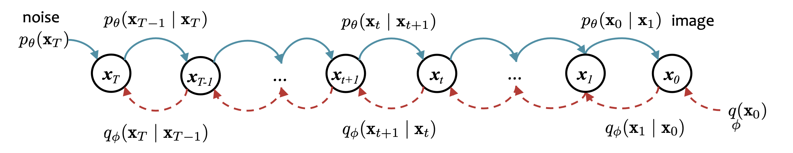
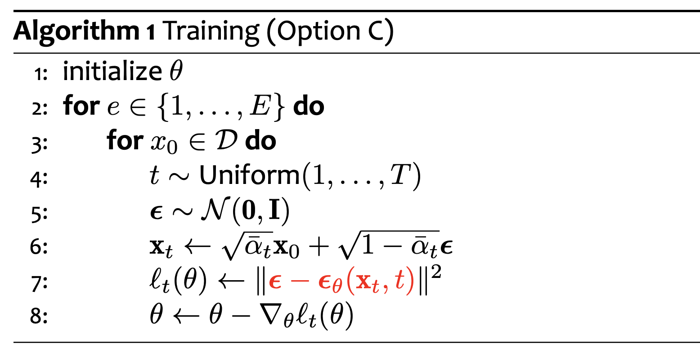
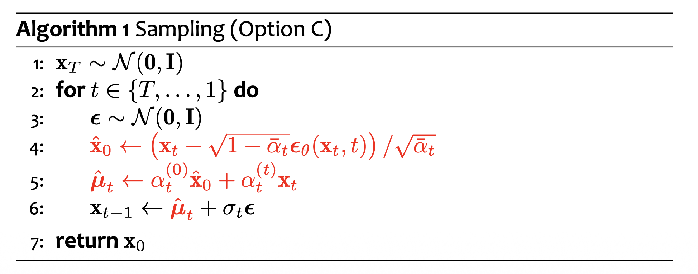

Diffusion model is a latent variable model.
$$
p_\theta(\mathbf x_0 | \mathbf x_1, \dots, \mathbf x_T)
$$

Forward process:
$$
q_\phi(\mathbf{x}_{o:T}) = q_\phi(\mathbf{x}_0) \prod_{t=1}^T q_\phi(\mathbf{x}_t | \mathbf{x}_{t-1})
$$
$$
q_\phi (x_0) = \text{data distribution}
$$
$$
q_\phi(\mathbf{x}_t | \mathbf{x}_{t-1}) \sim \mathcal{N}(\sqrt{\alpha_t} \mathbf{x}_{t-1}, (1 - \alpha_t)\mathbf{I})
$$

Exact reverse process:
$$
q_\phi(\mathbf{x}_{o:T}) = q_\phi(\mathbf{x}_T) \prod_{t=1}^T q_\phi(\mathbf{x}_{t-1} | \mathbf{x}_{t})
$$
$$
q_\phi(\mathbf x_T) \approx \mathcal N (\mathbf 0, \mathbf I)
$$
$$
q_\phi(\mathbf x_{t-1} | \mathbf x_t) = \text{intractable}
$$

Learned reverse process:
$$
p_\theta(\mathbf{x}_{0:T}) = p_\theta(\mathbf{x}_T) \prod_{t=1}^T p_\theta(\mathbf{x}_{t-1} | \mathbf{x}_t)
$$
$$
p_\theta(\mathbf{x}_T) \sim \mathcal{N}(\mathbf 0, \mathbf I)
$$
$$
p_\theta(\mathbf{x}_{t-1} | \mathbf{x}_t) \sim \mathcal{N}(\mu_\theta(\mathbf{x}_t, t), \Sigma_\theta(\mathbf{x}_t, t))
$$

The learned reverse process is trained such that:
$$
p_\theta(\mathbf x_{t-1} | \mathbf x_t) \approx q_\phi(\mathbf x_{t-1} | \mathbf x_t)
$$

# Forward Process
The forward process adds noise to the image.

In each step:
$$
q_\phi(\mathbf{x}_t | \mathbf{x}_{t-1}) \sim \mathcal{N}(\sqrt{\alpha_t} \mathbf{x}_{t-1}, (1 - \alpha_t)\mathbf{I})
$$

i.e. 
$$
\mathbf x_t = \sqrt a_t \mathbf x_{t-1} + \sqrt{1 - a_t} \mathbf \epsilon, \ \mathbf \epsilon \sim \mathcal N (0, \mathbf I)
$$

By properties of Gaussians:
$$
q_\phi(\mathbf x_t | \mathbf x_0) \sim \mathcal{N} (\sqrt{\bar \alpha_t} \mathbf x_0, (1 - \bar\alpha_t) \mathbf I)
$$
Where:
$$
\bar \alpha_t = \prod_{s=1}^t \alpha_s
$$

Therefore, we can choose the sequence $\alpha_t$ to follow a fixed schedule such that:
$$
1 > \bar \alpha_1​ > \bar \alpha_2 > \cdots > \bar \alpha_T​ \approx 0
$$
Thus,
$$
q_\phi(\mathbf{x}_T | \mathbf{x_0}) \sim \mathcal{N}(\mathbf 0, \mathbf I)
$$
Thus,
$$
q_\phi(\mathbf x_T) \sim \mathcal N(\mathbf 0, \mathbf I)
$$
is easy to sample from.

# Exact Reverse Process
Given the forward process, we can use the Bayes' Rule to derive the exact reverse process:  
$$
q_\phi(\mathbf{x}_{t-1} | \mathbf{x_t}) = \frac{q_\phi(\mathbf{x}_{t-1}, \mathbf{x}_t)}{q_\phi(\mathbf{x}_t)} = \frac{\int q_\phi(\mathbf{x}_{0:T}) d\mathbf{x}_{0:t-2} d\mathbf{x}_{t+1:T}}{\int q_\phi(\mathbf{x}_{0:T}) d\mathbf{x}_{0:t-1} d\mathbf{x}_{t+1:T}}
$$
However, this is intractable because $q_\phi(x_0)$ is unknown.

# Properties of Forward Process and Exact Reverse Process
**Property 1**.  
$$
q_\phi(\mathbf x_t | \mathbf x_0) \sim \mathcal{N} (\sqrt{\bar \alpha_t} \mathbf x_0, (1 - \bar\alpha_t) \mathbf I)
$$
Where:
$$
\bar \alpha_t = \prod_{s=1}^t \alpha_s
$$

i.e.
$$
\mathbf x_t = \sqrt{\bar \alpha_t} \mathbf x_0 + \sqrt{1 - \bar \alpha_t} \mathbf \epsilon
$$
Where:
$$
\mathbf \epsilon \sim \mathcal N(\mathbf 0, \mathbf I)
$$

**Property 2**.  
Estimating $q_\phi(\mathbf{x}_{t-1} | \mathbf{x}_t)$ is intractable. However, conditioning on $\mathbf{x}_0$ we can efficiently work with:
$$
q(\mathbf{x}_{t-1} | \mathbf{x}_t, \mathbf{x}_0) \sim \mathcal{N}(\tilde \mu_q(\mathbf{x}_t, \mathbf{x}_0), \sigma_t^2 \mathbf{I})
$$
$$
\tilde \mu_q(\mathbf{x}_t, \mathbf{x}_0) = \frac{\sqrt{\bar \alpha_t} (1- \alpha_t)}{1 - \bar \alpha_t} \mathbf{x}_0 + \frac{\sqrt{\alpha_t} (1 - \bar \alpha_t)}{1 - \bar \alpha_t} \mathbf{x}_t
$$
$$
\sigma_t^2 = \frac{(1 - \bar\alpha_{t-1})(1 - \alpha_t)}{1 - \bar\alpha_t}
$$

**Property 3**.  
Combining property 1 and 2, we can obtain a different parameterization of $\tilde \mu_q$:
$$
\tilde \mu_q (\mathbf{x}_t, \mathbf{x}_0) = \frac{1}{\sqrt{\alpha_t}} \left( \mathbf{x}_t - \frac{1 - \alpha_t}{\sqrt{1 - \bar \alpha_t}} \epsilon \right)
$$

# Learned Reverse Process
The learned reverse process trains a neural network to simulate the exact reverse process.

In each step:
$$
p_\theta(\mathbf{x}_{t-1} | \mathbf{x}_t) \sim \mathcal{N}(\mu_\theta(\mathbf{x}_t, t), \Sigma_\theta(\mathbf{x}_t, t))
$$

Note that although $p_\theta(\mathbf{x}_T)$ and $p_\theta(\mathbf{x}_{t-1} | \mathbf{x}_t)$ are Gaussians, $\mu_\theta$ is a **non-linear** neural network, so $p_\theta(x_0)$ is **no longer a Gaussian**. It is trained to simulate $q_\phi(x_0)$.

For the learned reverse process to simulate the exact reverse process, we want:
$$p_\theta(\mathbf x_{t-1} | \mathbf x_t) \approx q(\mathbf x_{t-1} | \mathbf x_t)$$

However, $q(\mathbf x_{t-1} | \mathbf x_t)$ is intractable.

Diffusion models maximizes log likelihood by maximizing ELBO:
$$
\log p_\theta(\mathbf x_0) = \mathbb E_{q(\mathbf x_1:\mathbf x_T|\mathbf x_0)} \left[ \log \frac{p_\theta(\mathbf x_0 : \mathbf x_T)}{q(\mathbf x_1 : \mathbf x_T | \mathbf x_0)} \right] + D_\text{KL} (q(\mathbf x_1 : \mathbf x_T || p_\theta(\mathbf x_1 : \mathbf x_T | \mathbf x_0)))
$$

Let
$$
\begin{aligned}
\text{ELBO}(\mathbf x_0; \theta) & = \mathbb E_{q(\mathbf x_1 : \mathbf x_T | \mathbf x_0)} \left[ \log \frac{p_\theta(\mathbf x_0 : \mathbf x_T)}{q(\mathbf x_1 : \mathbf x_T | \mathbf x_0)} \right]\\
& = \mathbb E_{q(\mathbf x_1 : \mathbf x_T | \mathbf x_0)} \left[ \log p_\theta(\mathbf x_T) + \sum_{t=2}^T \log \frac{p_\theta(\mathbf x_{t-1} | \mathbf x_t)}{q(\mathbf x_t | \mathbf x_{t-1})} + \log \frac{p_\theta(\mathbf x_0 | \mathbf x_1)}{q(\mathbf x_1 | \mathbf x_0)} \right]
\end{aligned}
$$

Note that
$$
q(\mathbf x_t | \mathbf x_{t-1}) = q(\mathbf x_t | \mathbf x_{t-1}, \mathbf x_0) = \frac{q(\mathbf x_{t-1} | \mathbf x_t, \mathbf x_0) q(\mathbf x_t | \mathbf x_0)}{q(\mathbf x_{t-1} | \mathbf x_0)}
$$

Thus
$$
\begin{aligned}
\text{ELBO}(\mathbf x_0; \theta) & = \mathbb E_{q(\mathbf x_1 : \mathbf x_T | \mathbf x_0)} \left[ \log p_\theta(\mathbf x_T) + \sum_{t=2}^T \log \frac{p_\theta(\mathbf x_{t-1} | \mathbf x_t)}{q(\mathbf x_t | \mathbf x_{t-1})} + \log \frac{p_\theta(\mathbf x_0 | \mathbf x_1)}{q(\mathbf x_1 | \mathbf x_0)} \right]\\
& = \mathbb E_{q(\mathbf x_1 : \mathbf x_T | \mathbf x_0)} \left[ \log p_\theta(\mathbf x_T) + \sum_{t=2}^T \log \frac{p_\theta(\mathbf x_{t-1} | \mathbf x_t) q(\mathbf x_{t-1} | \mathbf x_0)}{q(\mathbf x_{t-1} | \mathbf x_t , \mathbf x_0) q(\mathbf x_t | \mathbf x_0)} + \log \frac{p_\theta(\mathbf x_0 | \mathbf x_1)}{q(\mathbf x_1 | \mathbf x_0)} \right]\\
& = \mathbb E_{q(\mathbf x_1 : \mathbf x_T | \mathbf x_0)} \left[ \log p_\theta(\mathbf x_T) + \sum_{t=2}^T \log \frac{p_\theta(\mathbf x_{t-1} | \mathbf x_t)}{q(\mathbf x_{t-1} | \mathbf x_t , \mathbf x_0)} + \log \frac{q(\mathbf x_1 | \mathbf x_0)}{q(\mathbf x_T | \mathbf x_0)} + \log \frac{p_\theta(\mathbf x_0 | \mathbf x_1)}{q(\mathbf x_1 | \mathbf x_0)} \right]\\
& = \mathbb E_{q(\mathbf x_1 : \mathbf x_T | \mathbf x_0)} \left[ \log \frac{p_\theta(\mathbf x_T)}{q(\mathbf x_T | \mathbf x_0)} + \sum_{t=2}^T \log \frac{p_\theta(\mathbf x_{t-1} | \mathbf x_t)}{q(\mathbf x_{t-1} | \mathbf x_t , \mathbf x_0)} + \log p_\theta(\mathbf x_0 | \mathbf x_1) \right]\\
& = \mathbb E_{q(\mathbf x_T | \mathbf x_0)} \left[ \log \frac{p_\theta(\mathbf x_T)}{q(\mathbf x_T | \mathbf x_0)} \right] + \mathbb E_{q(\mathbf x_1 : \mathbf x_T | \mathbf x_0)} \left[ \sum_{t=2}^T \log \frac{p_\theta(\mathbf x_{t-1} | \mathbf x_t)}{q(\mathbf x_{t-1} | \mathbf x_t , \mathbf x_0)} \right] + \mathbb E_{q(\mathbf x_1 | \mathbf x_0)}[ \log p_\theta(\mathbf x_0 | \mathbf x_1)]\\
& = - D_\text{KL}(q(\mathbf x_T | \mathbf x_0)|| p_\theta(\mathbf x_T)) - \sum_{t=2}^T \mathbb E_{q(\mathbf x_t | \mathbf x_0)} \mathbb E_{q(\mathbf x_{t-1} | \mathbf x_t, \mathbf x_0)} \left[ \log \frac{q(\mathbf x_{t-1} | \mathbf x_t, \mathbf x_0)}{p_\theta(\mathbf x_{t-1} | \mathbf x_0)} \right] + \mathbb E_{q(\mathbf x_1 | \mathbf x_0)}[ \log p_\theta(\mathbf x_0 | \mathbf x_1)]\\
& = - D_\text{KL}(q(\mathbf x_T | \mathbf x_0)|| p_\theta(\mathbf x_T)) - \sum_{t=2}^T \mathbb E_{q(\mathbf x_t | \mathbf x_0)}[D_\text{KL}(q(\mathbf x_{t-1} | \mathbf x_t, \mathbf x_0) || p_\theta(\mathbf x_{t-1} | \mathbf x_0))] + \mathbb E_{q(\mathbf x_1 | \mathbf x_0)}[ \log p_\theta(\mathbf x_0 | \mathbf x_1)]\\
& = - L_T - \sum_{t=2}^T L_{t-1}  - L_0
\end{aligned}
$$

In Sohl-Dickstein et al., 2015, the parameters $\alpha$ of the forward process $q$ are trainable, $L_T \neq 0$. The paper samples a whole trajectory $\mathbf x0 : \mathbf x_T$, computes $\text{ELBO}(\mathbf x_0; \theta)$, and maximizes it. The gap term $D_\text{KL} (q(\mathbf x_1 : \mathbf x_T || p_\theta(\mathbf x_1 : \mathbf x_T | \mathbf x_0)))$ is ignored.

In Ho et al., 2020 (DDPM), the parameters $\alpha$ of the forward process $q$ are pre-defined, $L_T = 0$. The paer samples a single $\mathbf x_t$, computes $L_{t-1}$, and minimizes it. The gap term $D_\text{KL} (q(\mathbf x_1 : \mathbf x_T || p_\theta(\mathbf x_1 : \mathbf x_T | \mathbf x_0)))$ is ignored.

Given a specific training sample $\mathbf{x}_0$, and a specific timestamp $t$, we sample $\mathbf x_t \sim q(\mathbf x_t | \mathbf x_0)$,
$$
\mathbf \epsilon \sim \mathcal N(\mathbf 0, \mathbf I)
$$
$$
\mathbf x_t = \sqrt{\bar \alpha_t} \mathbf x_0 + \sqrt{1 - \bar \alpha_t} \mathbf \epsilon
$$
and optimize $\theta$ such that $p_\theta(\mathbf{x}_{t-1} | \mathbf{x}_t)$ is as close as possible to $q(\mathbf{x}_{t-1} | \mathbf{x}_t, \mathbf{x}_0)$.
$$
\theta^* = \arg\min_\theta D_\mathrm{KL}(q(\mathbf x_{t-1} | \mathbf x_t, \mathbf x_0) || p_\theta (\mathbf x_{t-1} | \mathbf x_t))
$$

If the model predicts
$$
\mathbf \epsilon_\theta(\mathbf x_t, t)
$$
minimizing KL divergence is equivalent to minimizing the L2 loss between the sampled $\epsilon$ and the predicted $\epsilon_\theta(\mathbf x_t, t)$.

# Training

# Sampling

Note that although $\epsilon(\mathbf x_t, t)$ is trained to predict the noise from $\mathbf x_0$ to $\mathbf x_t$ for each specific training sample $\mathbf x_0$, after being trained on the whole dataset, $\epsilon(\mathbf x_t, t)$ predicts the average noise from all possible $\mathbf x_0$ to $\mathbf x_t$.

Therefore, the $\hat{\mathbf x}_0$ here is the average of all possible $\mathbf x_0$, the $\hat{\mathbf \mu}_t$ here is the average of the mean of $q(\mathbf x_{t-1} | \mathbf x_{t}, \mathbf x_0)$, i.e. the mean of $q(\mathbf x_{t-1} | \mathbf x_t)$.