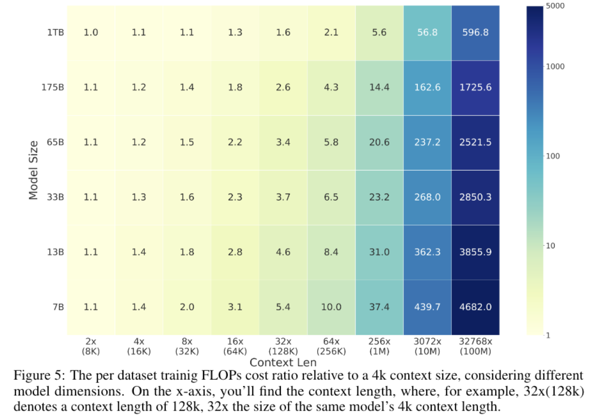
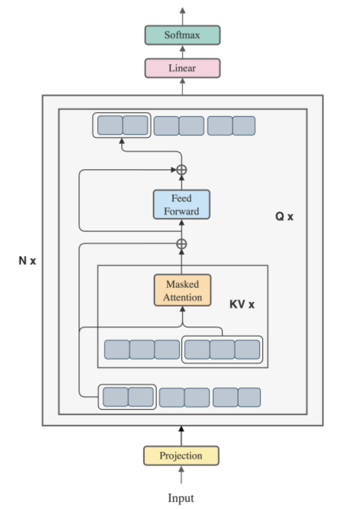
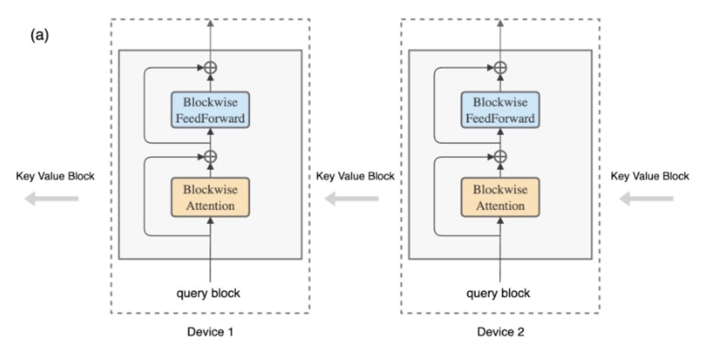

# In Context Learning
A model can learn to perform a task from examples in its prompt at inference time, without updating its parameters.

In context learning benefits from long context.

# Extending Short Context Models
General recipe
- Pre-train a short context model (e.g. block size = 4k) on 1 trillion tokens.
- Adjust the hyper-parameters of the extensible positional embeddings.
- Pre-train but increase the block size (e.g. block size = 80k) on only 5 billion tokens.

# Approximate Attention
Sliding window attention.
Sparse attention.
Dilated attention.

# Scaling Up Context Length
In transformers, the training FLOPS do not scale up as quickly as the context size.

# Blockwise Parallel Transformer
BPT computes **both attention and FFN layers** by iterating over query and key/value blocks.

# Ring Attention
Ring attention uses BPT to process long input sequences using many devices.
- Pass along the key-value blocks between devices.
- The length of the sequence that fits in VRAM scales with the number of devices.

