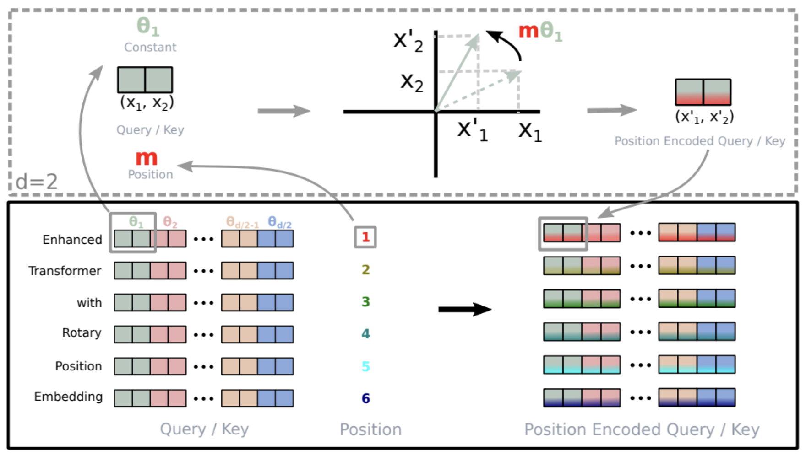
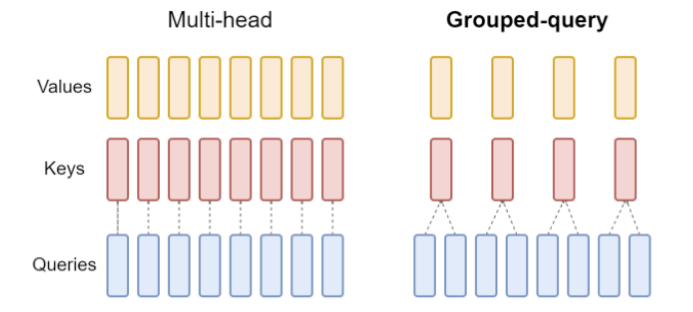
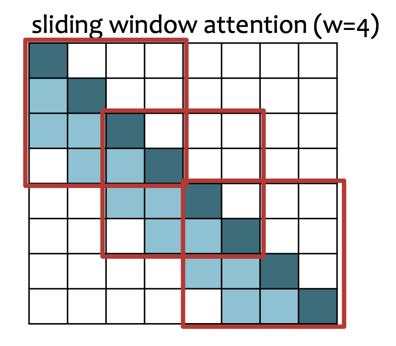

# RoPE
Rotary position embedding is a kind of **relative position embedding**. It is applied to **individual query and key vectors** in every layer to **inject relative position into their inner product**.

Key idea:
- break each d-dimensional query and key vector into d/2 vectors of length 2.
- rotate each of the d/2 vectors by an amount scaled by m.
- m is the absolute position of the query or the key.

For some fixed absolute position $m$, the rotary matrix $R_{\Theta, m}$ is given by
$$
R_{\Theta, m} = \begin{pmatrix}
\cos m\theta_1 & - \sin m\theta_1 & 0 & 0 & \dots & 0 & 0\\
\sin m\theta_1 & \cos m\theta_1 & 0 & 0 & \dots & 0 & 0\\
0 & 0 & \cos m\theta_2 & - \sin m\theta_2 & \dots & 0 & 0\\
0 & 0 & \sin m\theta_2 & \cos m\theta_2 & \dots & 0 & 0\\
\vdots & \vdots & \vdots & \vdots & \ddots & \vdots & \vdots\\
0 & 0 & 0 & 0 & \dots & \cos m\theta_{d_k / 2} & -\sin m\theta_{d_k / 2}\\
0 & 0 & 0 & 0 & \dots & \sin m\theta_{d_k / 2} & \cos m\theta_{d_k / 2}
\end{pmatrix}
$$

The $\theta_i$ are fixed ahead of time and defined as
$$
\theta_i = 10000^{-2(i-1) / d_k}, \ i = 1, \dots, d_k/2
$$

The inner product of query q at position m and key k at position n
$$
\langle R_m q,\ R_n k \rangle = q^\top R_m^\top R_n k = q^\top R_{n-m}\, k
$$
is only dependent on the relative position n-m.

Design:
- Why use into 2D rotations: 2D rotations are commutative.
- Why use different $\theta_i$: 
	- Large $\theta_i$ provides distinct rotations.
	- Small $\theta_i$ provides long cycles.

# GQA
Grouped query attention reduces the number of parameters by reusing the same key and value heads for multiple query heads.

$$
Q^{(i, j)} = X W_q^{(i, j)}, \ \forall i \in \{1, \dots, h_{kv}\}, \ \forall j \in \{1,\dots, g\}
$$
$$
K^{(i)} = X W_k^{(i)}, \ \forall i \in \{1, \dots, h_{kv}\} 
$$
$$
V^{(i)} = X W_v^{(i)}, \ \forall i \in \{1, \dots, h_{kv}\}
$$
$$
A^{(i, j)} = \mathrm{softmax} \left( \frac{Q^{(i, j)} {K^{(i)}}^T }{\sqrt{d_k}} \right)
$$
$${X'}^{(i, j)} = A^{(i, j)} V^{(i)}$$
$$
X' = \mathrm{concat} \left( {x'}^{(i, j)} \right)
$$
where
- $h_{kv}$ is the number of key and value heads.
- $h_q$ is the number of query heads.
- $g = h_q / h_{kv}$ is the number of query heads per group (key and value head).

# Sliding Window Attention
Sliding window attention reduces the complexity of attention by allowing each token to only look at w/2 tokens before it.

The receptive field of each token grows as the number of layers grows.

Sliding window attention is implemented by breaking Q and K into chunks of size w x w, with an overlap of w/2, then computing full attention within each chunk. Overlapping tokens are computed then discarded.