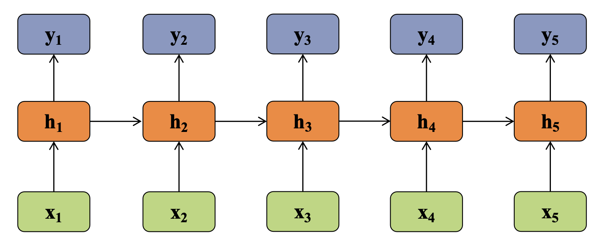
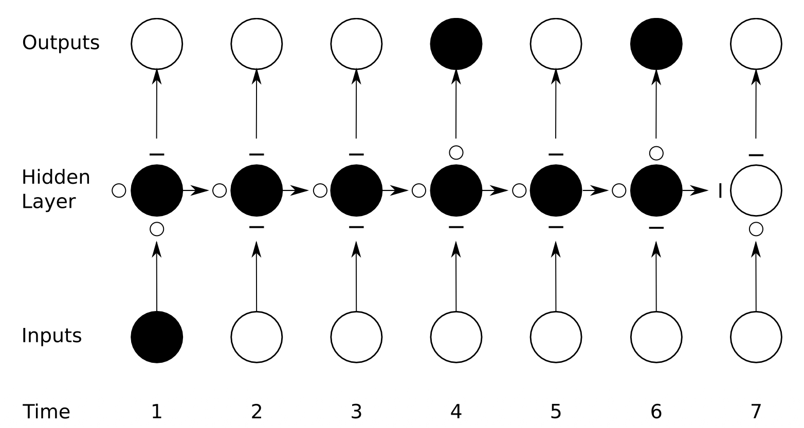

# N-Gram
An n-gram language model stores the probability of any word given any combination of n previous words in a table.

The number of parameters:
$$
(|V| - 1|) |V|^{n-1}
$$

An n-gram language model has many parameters, but most of them are wasted modeling unlikely combinations of words.

# RNN

$$
h_t = \mathcal H(W_x x_t + W_h h_{t-1} + b_h)
$$
$$
y_t = W_y h_t + b_y
$$

RNN suffers from:
- Long range dependency.
- Vanishing gradients.

# LSTM
LSTM improves RNN by using gates to remember and forget information.

LSTM suffers from:
- Long range dependency.
- Serial computation.
- Exploding gradients.