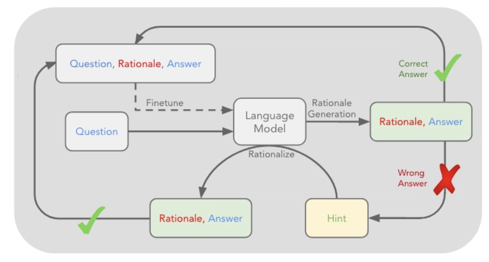
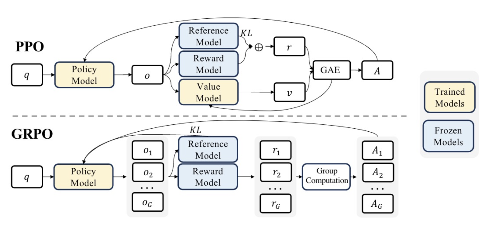

# STaR
STaR uses ICL to bootstrap rationales, then fine-tunes on rationales that led to correct answers.

# GRPO
GRPO is a variant of PPO that removes the value network to save memory and compute. It estimates the advantage by sampling a group of outputs from the old policy.

