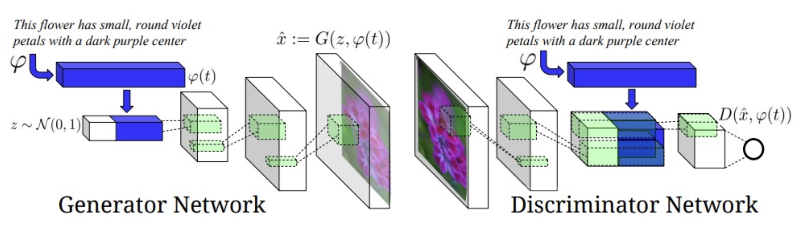
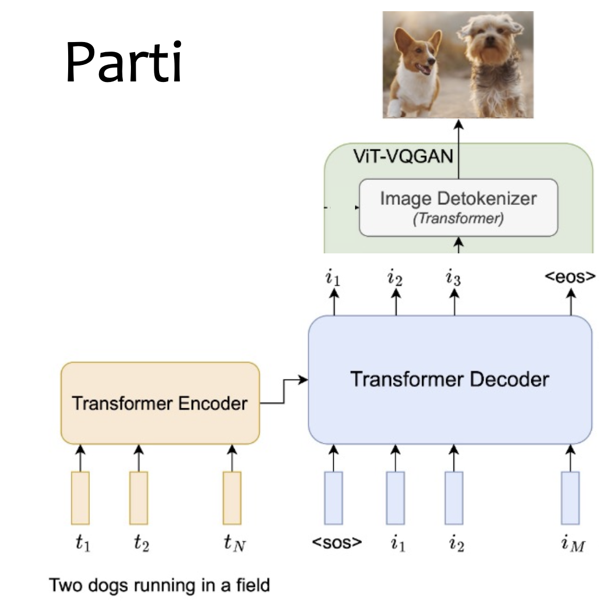
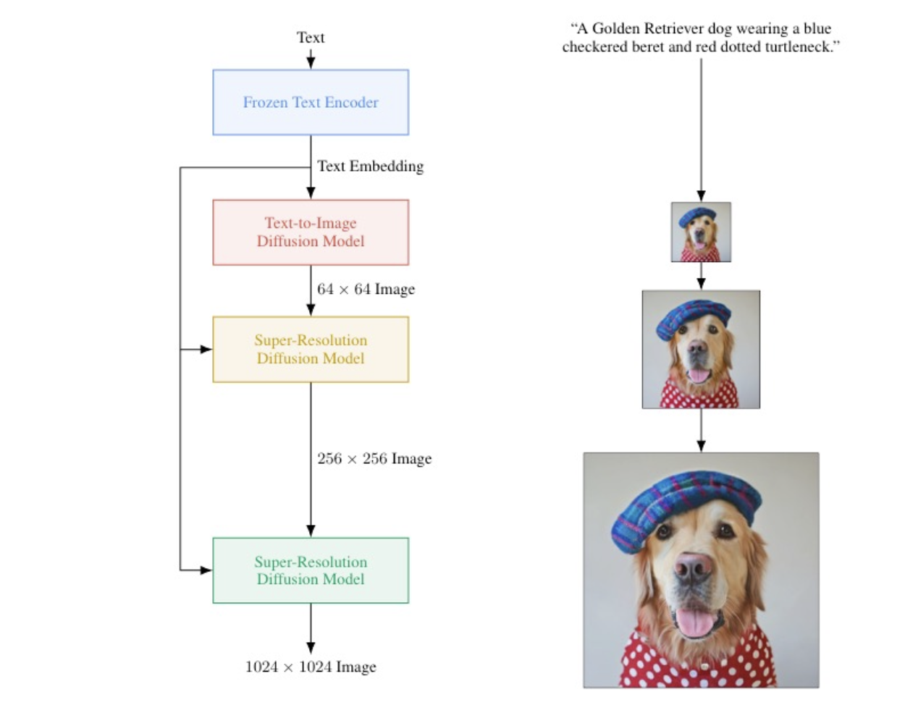

# Conditional GAN

# Autoregressive Models
ViT-VQGAN encode image into discrete tokens, and decode discrete tokens into image. A transformer model generates image tokens auto-regressively, ViT-VQGAN decodes them into image.

# Diffusion Models

# Latent Diffusion Models
[Diffusion Models 2](Diffusion%20Models%202.md)