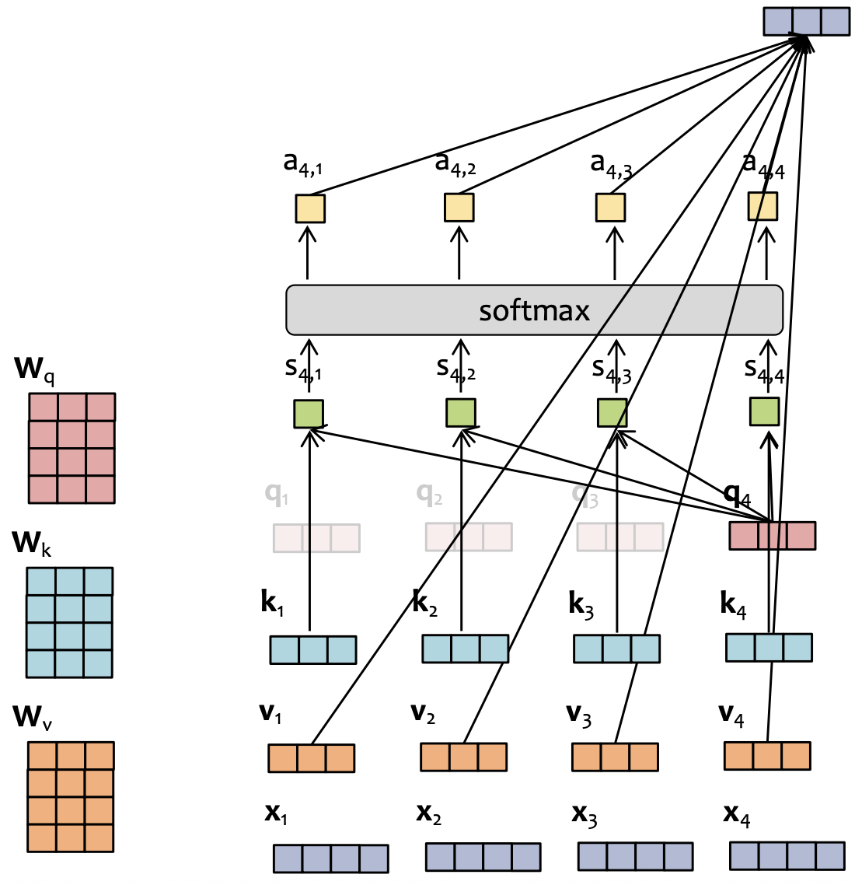
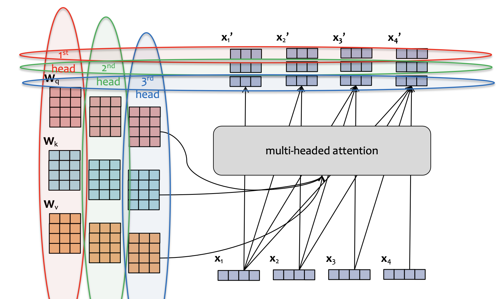
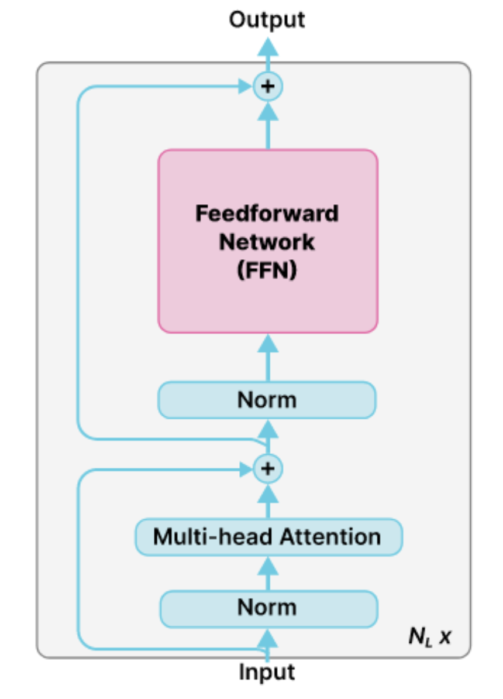
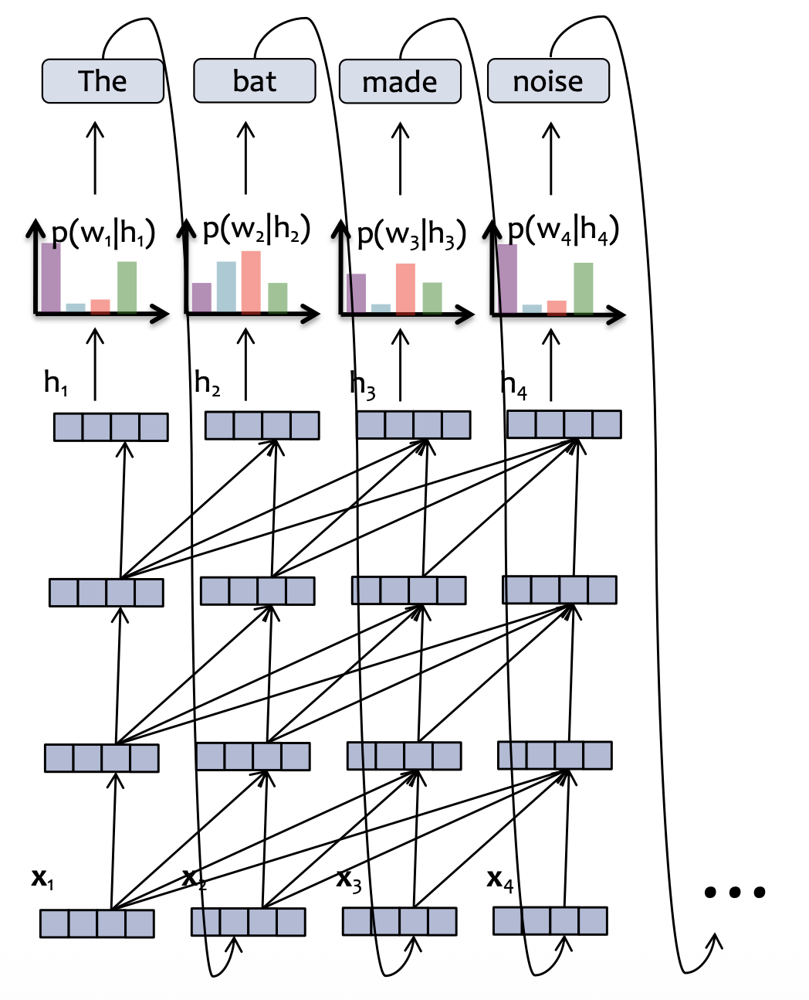
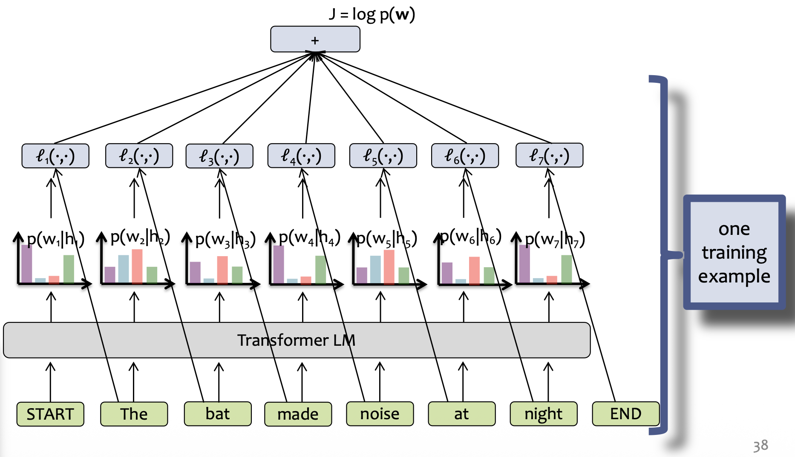
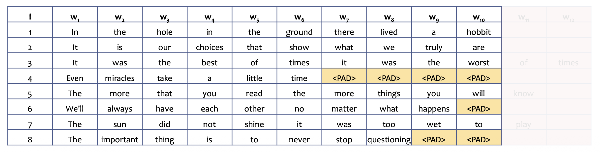
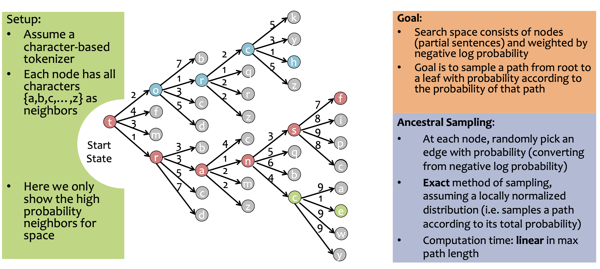

# SDPA
Scaled dot product attention:
$$
Q = X W_Q
$$
$$
K = X W_K
$$
$$
V = X W_V
$$
$$
X' = \mathrm{softmax} \left( \frac{QK^T}{\sqrt{d_k}} \right) V
$$



# Multi-Headed Attention
In multi-headed attention:
- Each head gets its own parameters.
- Outputs from all heads are concatenated to form a single vector. 
- Outputs from all heads are fused by a **linear layer**.
- Embedding sizes and number of heads are picked, such that the concatenated output has the same dimensions as the input.



To balance performance and compute, usually
$$
d_\text{model} = h \times d_\text{head}
$$

# Transformer Layer
A transformer layer combines:
- Multi-headed attention block.
- Residual connections.
- Layer normalizations.
- FFN.



# Causal Attention
In a transformer language model, each hidden vector looks at the hidden vectors of **the current and the previous timesteps**. This is called **causal attention**.



Details:
- $x_1$ is a special **start token**.
- Labels are shifted by 1 position, output at position t predicts label t+1.

Such dependency is enforced by applying a **causal attention mask** to the attention scores.
$$
M = \begin{bmatrix}
0 & -\infty & -\infty & -\infty\\
0 & 0 & -\infty & -\infty\\
0 & 0 & 0 & -\infty\\
0 & 0 & 0 & 0
\end{bmatrix}
$$
$$
X' = \mathrm{softmax} \left( \frac{QK^T}{\sqrt{d_k}} + M \right) V
$$

Note that causal attention is applied in **every layer**. It describes how each token attends to other tokens in each layer.

Causal attention has 2 main advantages:
- **During training, one forward pass produces predictions for all tokens in the sequence**, they can be trained together using a single forward pass.
- **During generation, keys and values of old tokens never change**, they can be reused when generating subsequent new tokens (**KV cache**).

# Transformer LM
The transformer language model is trained with cross entropy loss on each prediction. 



For each training sample, at timestep t:
$$
l_t = - \log p(w_t|w_{t-1}, \dots, w_0)
$$

The total loss for the training sample:
$$
l = \sum_{t=1}^T l_t = - \log p(w_1, \dots, w_t | w_0)
$$

This is the negative log probability of the whole sentence.

# Batching, Padding and Truncation
To put multiple sentences into a single batch:
- Short sentences are padded.
- Long sentences are truncated.



Pad tokens are ignored in the loss function.

# Sampling


# Parameter Count

|                  | GPT-3  |
| ---------------- | ------ |
| vocab            | 50,257 |
| d_model          | 12288  |
| n_heads          | 96     |
| n_layers         | 96     |
| d_ff             | 49152  |
| LayerNorm (B)    | 0.00   |
| Embedding (B)    | 0.62   |
| Attention (B)    | 57.99  |
| Feed-forward (B) | 115.97 |
| Total (B)        | 174.57 |
LayerNorm:
```
n_layers * 2 * (2 * d_model)
```

Embedding:
```
vocab * d_model
```

Attention:
```
n_layers * (4 * (d_model**2 + d_model))
```

Linear:
```
n_layers * (2 * d_model * d_ff + d_model + d_ff)
```

We often choose `d_ff = 4 * d_model` -> linear layers have more parameters than attention blocks.

