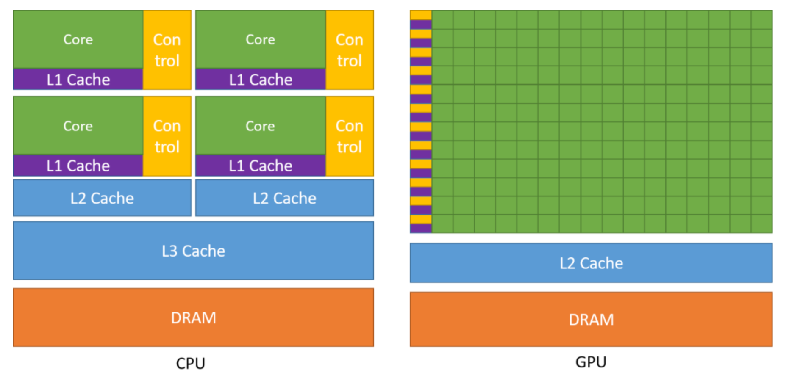
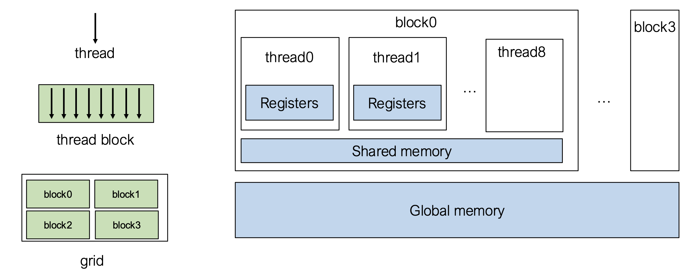
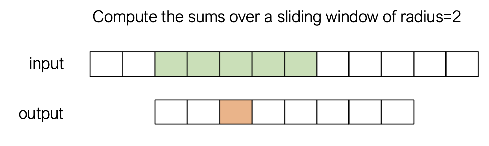
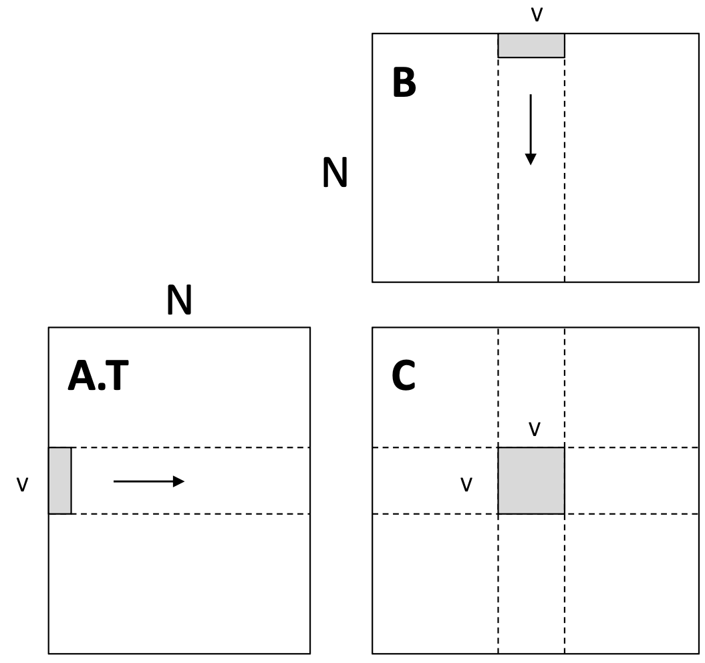
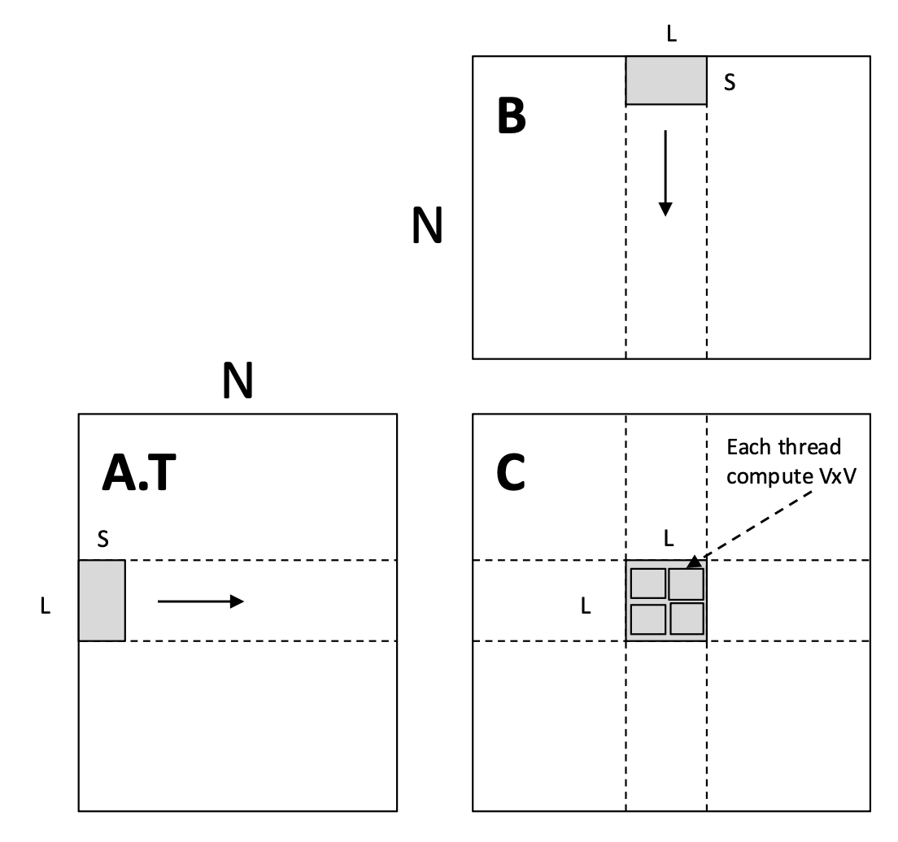

# Memory Hierarchy


**Cache** is controlled by the hardware.
- **L1 cache** is shared by all threads in the same SM.
- **L2 cache** is shared by all SMs.



**Shared memory** is controlled by the programmer. It is shared by all threads in the same block.

# Window Sum


Window sum: each thread loads its own data and performs window sum.
```cpp
#define RADIUS 2
__global__ void WindowSumSimpleKernel(float* A, float *B, int n) {
	int out_idx = blockDim.x * blockIdx.x + threadIdx.x;
	if (out_idx < n) {
		float sum = 0;
		for (int dx = -RADIUS; dx <= RADIUS; ++dx) {
			sum += A[dx + out_idx + RADIUS];
		}
		B[out_idx] = sum;
	}
}
```

Window sum with shared memory: all threads work together to load the block's data into shared memory before performing window sum.
```cpp
__global__ void WindowSumSharedKernel(float* A, float *B, int n) {
	# allocate shared memory
	__shared__ float temp[THREADS_PER_BLOCK + 2 * RADIUS];
	
	# load the block's data into shared memory
	int base = blockDim.x * blockIdx.x;
	int out_idx = base + threadIdx.x;
	if (out_idx < n) {
		temp[threadIdx.x] = A[out_idx];
	}
	if (threadIdx.x < 2 * RADIUS && base + THREADS_PER_BLOCK + threadIdx.x < n) {
		temp[threadIdx.x + THREADS_PER_BLOCK] = A[base + THREADS_PER_BLOCK + threadIdx.x];
	}
	
	# synchronize the block's threads before reading from shared memory
	__syncthreads();
	
	# window sum with shared memory
	if (out_idx < n) {
		float sum = 0;
		for (int dx = -RADIUS; dx <= RADIUS; ++dx) {
			sum += temp[threadIdx.x + dx + RADIUS];
		}
		B[out_idx] = sum;
	}
}
```

# Matrix Multiplication
**Thread level register tiling.**
For each thread, use the register tiling technique to load as many elements into the register before performing matrix multiplication.



```cpp
__global__ void mm(float A[N][N], float B[N][N], float C[N][N]) {
	int ybase = blockIdx.y * blockDim.y + threadIdx.y;
	int xbase = blockIdx.x * blockDim.x + threadIdx.x;
	
	float c[V][V] = {0};
	float a[V], b[V];
	for (int k = 0; k < N; ++k) {
		a[:] = A[k, ybase*V : ybase*V + V];
		b[:] = B[k, xbase*V : xbase*V + V];
		for (int y = 0; y < V; ++y) {
			for (int x = 0; x < V; ++x) {
				c[y][x] += a[y] * b[x];
			}
		}
	}
	C[ybase * V : ybase*V + V, xbase*V : xbase*V + V] = c[:];
}
```

**Block level shared memory tiling.**
For each block, load as many elements into the shared memory before performing thread level register tiling matrix multiplication.



```cpp
__global__ void mm(float A[N][N], float B[N][N], float C[N][N]) {
	__shared__ float sA[S][L], sB[S][L];
	float c[V][V] = {0};
	float a[V], b[V];
	
	int yblock = blockIdx.y;
	int xblock = blockIdx.x;
	for (int ko = 0; ko < N; ko += S) {
		__syncthreads();
		// thread cooperative fetching
		sA[:, :] = A[ko : ko + S, yblock * L : yblock * L + L];
		sB[:, :] = B[ko : ko + S, xblock * L : xblock * L + L];
		__syncthreads();
		
		for (int ki = 0; ki < S; ++ki) {
			a[:] = sA[ki, threadIdx.y * V : threadIdx.y * V + V];
			b[:] = sB[ki, threadIdx.x * V : threadIdx.x * V + V];
			for (int y = 0; y < V; ++y) {
				for (int x = 0; x < V; ++x) {
					c[y][x] += a[y] * b[x];
				}
			}
		}
	}
	int ybase = blockIdx.y * blockDim.y + threadIdx.y;
	int xbase = blockIdx.x * blockDim.x + threadIdx.x;
	C[ybase * V : ybase*V + V, xbase*V : xbase*V + V] = c[:];
}
```

The thread cooperative fetching can be achieved efficiently using **tensor memory accelerators (TMAs)**. TMAs move large blocks of data between global memory and shared memory without the threads doing the work.

More GPU optimization techniques:
- Global memory continuous reads.
- Shared memory bank conflicts.
- Software pipelining.
- Warp level optimizations.
- Tensor cores.