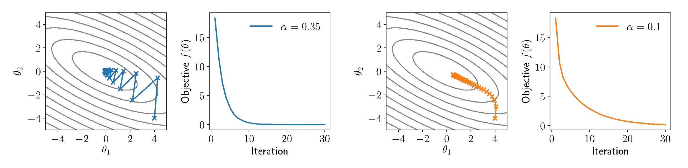
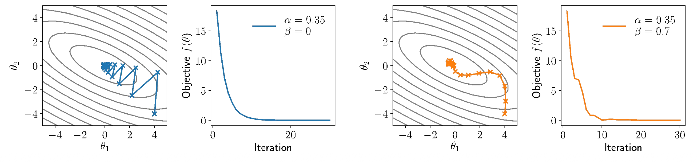

# SGD
The update direction is the gradient.
$$
\theta_{t+1} = \theta_t - \alpha \nabla_\theta f(\theta_t) 
$$

# SGD with Weight Decay
SGD with weight decay limits overfitting by keeping weights small:
$$ 
\theta_{t+1} = (1 - \alpha \lambda) \theta_t - \alpha \nabla_\theta f(\theta_t)
$$

It is equivalent to adding the L2 regularization:
$$
\frac{\lambda}{2}\|w\|_2^2
$$

# SGD with Momentum
The update direction is the EMA of the gradient.

In SGD with momentum, the gradient directly affect the velocity (update direction of the parameters) instead of the position (parameters).

Form 1:
$$
v_{t+1} = \beta v_t + \nabla_\theta f(\theta_t)
$$
$$
\theta_{t+1} = \theta_t - \alpha v_{t+1}
$$

Form 2:
$$
v_{t+1} = \beta v_t + (1 - \beta) \nabla_\theta f(\theta_t)
$$
$$
\theta_{t+1} = \theta_t - \alpha v_{t+1}
$$

If $v_0 = 0$, then $v_t^{(2)} = v_t^{(1)} (1 - \beta)$. Form 1 and 2 are equivalent when $\alpha^{(2)} = \alpha^{(1)} / (1 - \beta)$.

If $v_0 = 0$, the first few $v_t$ will be very small. Form 3 divides $v_t$ by $1 - \beta^t$ to correct this bias
$$
v_{t+1} = \beta v_t + (1 - \beta) \nabla_\theta f(\theta_t)
$$
$$
\theta_{t+1} = \theta_t - \alpha v_{t+1} / (1 - \beta^{t+1})
$$
such that the weight of all gradients that contribute to $v_t$ always sum to 1.

Momentum “smooths” out the descent, but can also introduce other forms of oscillation and non-descent behavior.

# SGD with Nesterov Momentum
The gradient is computed after the momentum step.
$$
v_{t+1} = \beta v_t + (1 - \beta) \nabla_\theta f(\theta_t - \alpha v_t)
$$
$$
\theta_{t+1} = \theta_t - \alpha v_{t+1}
$$

# AdaGrad
An improved version of SGD, with the following improvements:
- **Learning rate decay**.
- **Per-parameter adaptive learning rate**: Parameters with large gradients have bigger learning rate decay, parameters with small gradients have smaller learning rate decay. This reduces oscillation.

$$
G_{t+1} = G_t + \nabla_\theta f(\theta_t) \odot \nabla_\theta f(\theta_t)
$$
$$
\theta_{t+1} = \theta_t - \frac{\alpha}{\sqrt{G_{t+1}} + \epsilon} \odot \nabla_\theta f(\theta_t)
$$

The learning rate is **monotonically decreasing**. The network may stop learning too early.

# RMSProp
An improved version of AdaGrad. The `cache` is the the EMA of squared gradients. Therefore, the learning rate is no longer monotonically decreasing.
$$
G_{t+1} = \beta G_t + (1 - \beta) (\nabla_\theta f(\theta_t))^2
$$
$$
\theta_{t+1} = \theta_t - \frac{\alpha}{\sqrt{G_{t+1}} + \epsilon} \nabla_\theta f(\theta_t)
$$

# Adam
Adam is a combination of **SGD with Momentum** and **RMSProp**. It replaces the gradient in RMSProp with the EMA of the gradient and applies bias correction. 
$$
m_{t+1} = \beta_1 m_t + (1 - \beta_1) \nabla_\theta f(\theta_t) 
$$
$$
v_{t+1} = \beta_2 v_t + (1 - \beta_2) (\nabla_\theta f(\theta_t))^2
$$
$$
\hat m_{t+1} = \frac{m_{t+1}}{1 - \beta_1^{t+1}}
$$
$$
\hat v_{t+1} = \frac{v_{t+1}}{1 - \beta_2^{t+1}}
$$
$$
\theta_{t+1} = \theta_t - \frac{\alpha}{\sqrt{\hat v_{t+1}} + \epsilon} \hat m_{t+1}
$$

# AdamW
AdamW is Adam with decoupled weight decay. Instead of adding the L2 regularization, weight decay is applied directly to the weights.
$$
\theta_{t+1} = (1 - \alpha \lambda) \theta_t - \frac{\alpha}{\sqrt{\hat v_{t+1}} + \epsilon} \hat m_{t+1}
$$